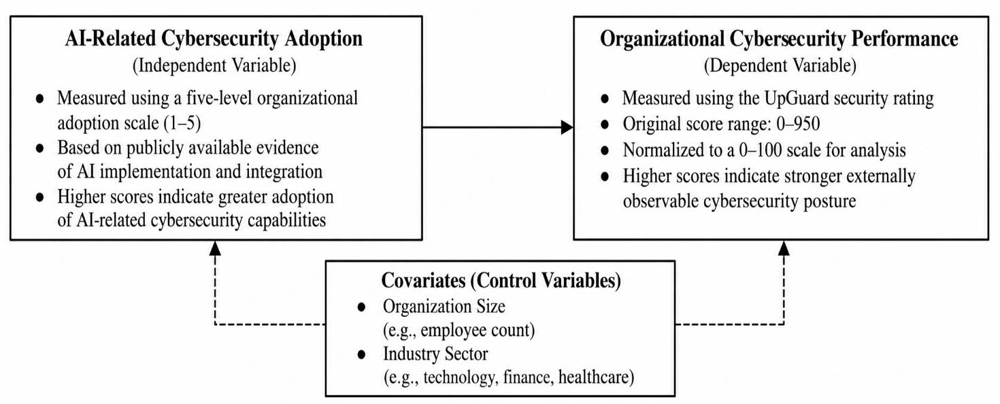

# AI-Related Cybersecurity Adoption and Cybersecurity Performance

Companion reproducibility repository for the doctoral dissertation:

> Lyons, C. (2026). *Organizational AI-Related Cybersecurity Adoption and Cybersecurity Performance: A Quantitative Correlational Analysis* [Doctor of Science dissertation]. College of Business, Innovation, Leadership, and Technology.

This repository contains the analysis-ready dataset, the full coding audit trail (evidence excerpt, source URL and rationale for every score), the coding rubric, and a dependency-light Python script that reproduces the statistical analysis.

## Study in brief

| | |
|---|---|
| Design | Quantitative, non-experimental, correlational |
| Unit of analysis | Organization (N = 35, purposive sample, 8 industry sectors) |
| Independent variable | Organizational AI-related cybersecurity adoption, a researcher-developed 1-5 ordinal scale coded from public evidence |
| Dependent variable | UpGuard security rating (0-950), rescaled to 0-100: `(rating / 950) * 100` |
| Covariates | Organization size (employees, log-transformed), industry (indicator variables) |
| Frameworks | Technology-Organization-Environment (TOE); NIST Risk Management Framework |
| Analyses | Spearman's rho (primary); Pearson's r and multiple regression (exploratory) |

**Headline finding (as reported in the dissertation):** no statistically significant association between AI adoption and cybersecurity performance; the null hypothesis was not rejected. The findings do not establish causation.



## Repository layout

```
data/
  organizations.csv          Final analytic dataset (Dissertation Table C3), 35 rows
  coding_audit_trail.csv     Prior/audited score, evidence excerpt, source URL, rationale (Table C2)
  appendix_a_version.csv     Earlier dataset version printed in Appendix A (kept for transparency)
docs/
  codebook.md                Data dictionary
  rubric.md                  1-5 AI-adoption coding rubric and coding rules
  RECONCILIATION.md          Known differences between the dissertation text and this dataset  <- read this
  figures/conceptual_model.png
src/analysis.py              Reproduces descriptives, correlations and regression
tests/                       Data-integrity and reproduction tests
results/                     Output of `python src/analysis.py`
```

## Quick start

Requires Python 3.9+.

```bash
git clone https://github.com/cl96534/ai-cybersecurity-adoption-performance.git
cd ai-cybersecurity-adoption-performance
pip install -r requirements.txt
python src/analysis.py          # prints results and writes results/
python -m unittest discover -s tests -v
```

## Results produced from `data/organizations.csv`

| Statistic | Value |
|---|---|
| AI adoption score, M (SD) | 2.03 (1.34) |
| Cybersecurity performance, M (SD) | 85.38 (3.72) |
| Spearman rho (primary) | 0.101, p = .564 |
| Pearson r | 0.055, p = .753 |
| Regression R² / adj. R² | .455 / .258 |
| Regression F(9, 25) | 2.316, p = .047 |
| AI adoption coefficient | B = 0.472, p = .362 |

These match Dissertation Tables 3-5. Two small typos remain in the dissertation's abstract (AI coefficient p-value and F rounding); see [docs/RECONCILIATION.md](docs/RECONCILIATION.md). The conclusion (no significant AI-adoption effect) is unaffected.

## Data provenance and caveats

- All data are secondary and publicly sourced (annual reports, SEC filings, security blogs, UpGuard). No human participants were involved.
- AI-adoption scores were assigned by **one researcher**; no inter-rater statistic exists. A score of 1 means qualifying evidence was not found in the reviewed record, not that no capability exists.
- UpGuard ratings are point-in-time and reflect *externally observable* security posture only. A dated UpGuard screenshot was not retained, and current ratings will differ from those used here.
- Purposive sample of 35 large, well-known organizations; results do not generalize to the population of organizations.
- The regression has about 3.9 observations per predictor and is exploratory.
- UpGuard ratings are third-party data; check UpGuard's terms before reusing them beyond verification of this study.

## Citing

See [CITATION.cff](CITATION.cff). GitHub's "Cite this repository" button uses that file.

## License

Code: [MIT](LICENSE). Data, documentation and figures: [CC BY 4.0](LICENSE-DATA). Cited source material remains the property of its original owners.
